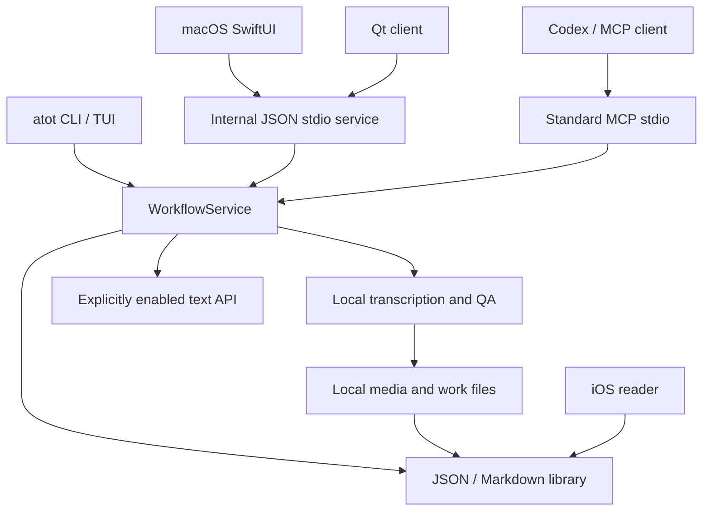

# SonaFolio architecture

SonaFolio combines local transcription with a portable podcast library. Stable macOS ASR uses MLX
Whisper on Apple Silicon; Windows uses faster-whisper. SwiftUI and Qt share a JSON/Markdown library.
iOS reads documents and manages subscriptions. Linux has a Qt client but no stable ASR backend.

## Entry points



MCP and internal JSON stdio use different protocols. MCP exposes library lookup, paged reading, and
agent-authored summary publication. The internal service exposes GUI workflows. The optional HTTP
service requires loopback and its own token; it is not an unauthenticated remote API.

## Python modules

| Module | Responsibility |
| --- | --- |
| `cli.py`, `commands/`, `tui.py` | CLI v2 routing, argument parsing, interactive entrypoint |
| `workflow_service.py`, `service_protocol.py` | Tasks, events, app contracts, orchestration |
| `pipeline/`, `pipeline_*.py` | Audio preparation, chunks, ASR, postprocessing, run metadata |
| `backends/`, `models.py` | Platform adapters, normalized results, local model resolution |
| `qa/`, `qa_*.py`, `repair.py` | Reports, problem windows, explicit local retranscription |
| `corrections.py`, `review.py`, `entity_consistency.py` | Narrow corrections and review evidence |
| `library_store.py`, `subscriptions.py` | Authoritative schema, subscriptions, state, tombstones |
| `mcp_server.py`, `agent_summary.py` | Four restricted tools, versioned writes, provenance |
| `cloud/` | Optional text preparation, summaries, titles, review APIs |
| `config_v2.py`, `credentials.py`, `redaction.py` | Settings, secure credential storage, redaction |
| `candidate/` | Experimental comparisons and promotion gates |

`src/atot/data/` holds model inventory, service contracts, and language rules. Model aliases and
manual URLs are maintained in `model_inventory.json`. A buildable candidate is not automatically a
production backend.

## Transcription and publication

1. The CLI or app calls `WorkflowService.run_transcribe()` or `run_import_xiaoyuzhou()`.
2. The pipeline prepares audio, fingerprints and chunks, invokes ASR, and retains auditable outputs.
3. QA and review artifacts identify possible problems. `repair` is an explicit local enhancement.
4. Readable transcripts are published to the library; audio and processing artifacts stay local.
5. Default processing ends at local transcription and QA. Cloud summary execution requires opt-in.

Codex can author `summary.md` through MCP after reading the complete transcript and QA. Publication
requires current transcript/summary hashes. Existing nonempty summaries need an explicit regeneration
request; version conflicts fail clearly.

## Storage

```text
SpeechToTextData/
  env/                 Python runtime
  model/               Manually installed weights
  materials/           Media and private import metadata
  work/                Transcription, QA, repair and cloud artifacts
  cache/               Logs, tools and temporary indexes
  Audio2TextLibrary/   Local-storage authoritative library
```

In iCloud mode the authoritative folder is `Audio2Text/Audio2TextLibrary/` in visible iCloud Drive.
Work files remain local. `episode.json` holds episode state; `documents/transcript.md` and
`documents/summary.md` hold readable content; `tombstones/` records deletion.
See [library layout](LIBRARY_LAYOUT.md).

## Clients, privacy, and distribution

SwiftUI macOS invokes the bundled compatibility CLI and scans the library directly. iOS uses Files
bookmarks, reads documents, and manages subscriptions/state without ASR. Qt reads the same library
and invokes external `atot` for workflows. Internal module and storage identities remain stable;
see [branding](BRANDING.md).

Local ASR does not upload audio. iCloud, agent clients, and cloud APIs are separate opt-in data paths.
A local MCP transport does not imply local model inference. Credentials use system secure storage
without silent plaintext substitution.

GitHub Actions validates Python, Swift, and three-platform Qt. Tags build four installers and verify
source provenance, licensing, and hashes before publication. macOS uses ad-hoc signing. The English
website has independent strict MkDocs builds and Pages deployment without ASR or model dependencies.

[Development](TECHNICAL_GUIDE.md) · [Releases](CI_RELEASES.md) · [Privacy](PRIVACY.md)
