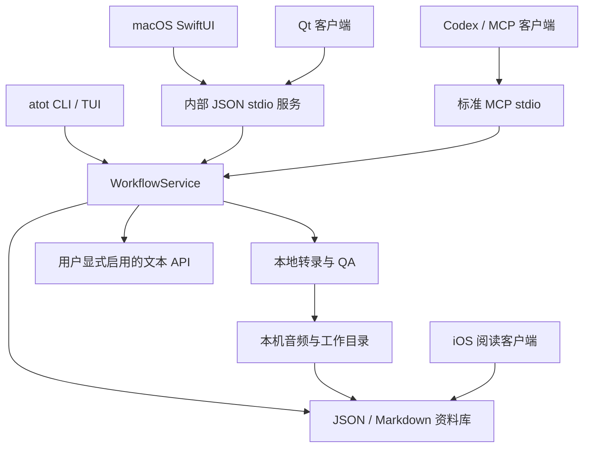

# SonaFolio 架构

SonaFolio 是本地优先的播客转录与资料库软件。macOS / Apple Silicon 的稳定 ASR 使用 MLX Whisper，
Windows 使用 faster-whisper。SwiftUI 与 Qt 客户端共享 JSON / Markdown 资料库；iOS 负责阅读和订阅管理。
Linux Qt 客户端可浏览资料库，Linux ASR 尚未作为稳定后端提供。

## 入口与边界



MCP 和内部 JSON stdio 是不同协议。MCP 只有资料库查询、分页读取与 Agent 摘要回写；
内部服务提供 GUI 的工作流接口。HTTP 服务必须使用 loopback 与独立 token，不能作为无鉴权的远程 API。

## Python 核心

| 模块 | 职责 |
| --- | --- |
| `src/atot/cli.py`、`commands/`、`tui.py` | 参数解析、CLI v2 的 `exec` 路由与交互入口 |
| `workflow_service.py`、`service_protocol.py` | 任务、事件、App 命令契约与统一流程编排 |
| `pipeline/`、`pipeline_*.py` | 输入准备、切块、ASR、后处理、运行元信息和文件发布 |
| `backends/`、`models.py` | 平台后端、规范化 ASR 结果与本地模型解析 |
| `qa/`、`qa_*.py`、`repair.py` | QA 报告、问题窗口与显式局部重转录 |
| `corrections.py`、`review.py`、`entity_consistency.py` | 窄范围修正、审阅线索与一致性检查 |
| `library_store.py`、`subscriptions.py` | 权威库 schema、订阅、状态与删除标记 |
| `mcp_server.py`、`agent_summary.py` | 四个受限 MCP 工具、版本化摘要回写与来源记录 |
| `cloud/` | 可选文本准备、摘要、标题和审阅 API 阶段 |
| `config_v2.py`、`credentials.py`、`redaction.py` | 配置、系统凭据与脱敏边界 |
| `candidate/` | 实验后端对比与晋升门禁；脚本仅作为入口 |

`src/atot/data/` 保存模型清单、服务契约、术语与审阅规则。模型别名和手动下载地址以
`model_inventory.json` 为单一维护入口。新增候选后端不能直接替换稳定后端。

## 转录与文档

1. CLI 或 App 将输入交给 `WorkflowService.run_transcribe()` 或 `run_import_xiaoyuzhou()`。
2. 管线准备音频、切块与指纹，调用平台 ASR，保存原始结果及可审计后处理输出。
3. QA 和审阅文件提供问题位置；`repair` 是用户显式选择的局部重转录。
4. 可读转录发布到权威资料库，原始音频和过程文件继续留在本机。
5. 默认处理结束于本地转录与 QA；可选云 API 总结仅在用户启用时运行。

`summary.md` 也可由 Codex 通过 MCP 完成。Agent 必须读完转录和 QA，回写时提供当前转录和摘要哈希。
已存在非空摘要时需要显式再生成授权；版本冲突应明确失败，不生成替代输出。

## 存储

```text
SpeechToTextData/
  env/                 Python 运行环境
  model/               手动放置的模型
  materials/           本机音视频与私有导入元信息
  work/                转录、QA、repair、cloud 过程文件
  cache/               日志、工具与临时索引
  Audio2TextLibrary/   本地存储模式的权威库
```

iCloud 模式下权威库位于可见 iCloud Drive 的 `Audio2Text/Audio2TextLibrary/`，过程文件不随之移动。
库内 `episode.json` 保存节目元信息和状态，`documents/transcript.md` 与 `documents/summary.md`
保存可读文档。删除标记位于 `tombstones/`。详细约束见[资料库布局](LIBRARY_LAYOUT.md)。

## 客户端

SwiftUI macOS 通过随包 CLI 启动内部服务，直接扫描资料库用于阅读。
iOS 通过 Files 书签访问同一资料库，读写订阅与阅读状态，不运行本地 ASR。
Qt 使用 C++ / QML，直接读取资料库并通过外部 `atot` 调用工作流。

GUI 名称为 SonaFolio；Swift 模块、CMake target、bundle ID、资料库 kind 和设置键保留兼容身份。
原因见[品牌说明](BRANDING.md)。这些内部名称不能代替产品文案。

## 隐私与发行

本地 ASR 不上传音频。iCloud、MCP 客户端与云 API 是用户选择的独立数据路径；
MCP 的本机 transport 不代表 Agent 模型本地运行。凭据使用系统安全存储，没有静默明文替代。

GitHub Actions 分别验证 Python、Swift 与三平台 Qt。Tag 构建四种原生安装包，
要求产物同源、许可材料完整和哈希一致，再发布。当前 macOS 为 ad-hoc 签名。
官网使用独立 MkDocs 严格构建与 Pages 部署，不依赖 ASR、模型或私有配置。

[开发指南](TECHNICAL_GUIDE.md) · [CI 与发行](CI_RELEASES.md) · [隐私](PRIVACY.md)
